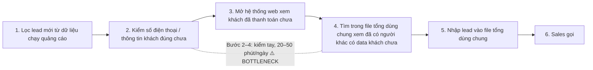
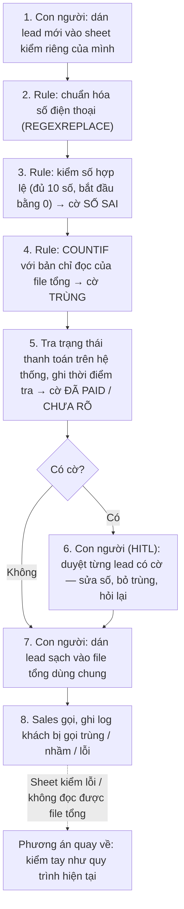
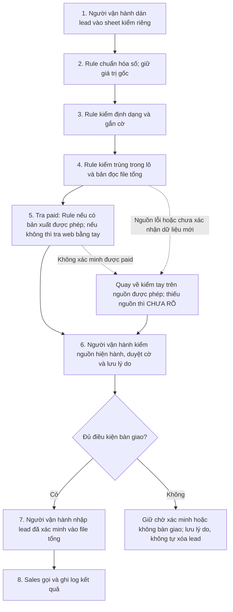

# Báo cáo nhóm — Day 02 Discovery & Problem Framing

## 1. Thông tin nhóm và trạng thái báo cáo

- Tên nhóm: **AIphevat**.
- Thành viên và phân công: xem [TEAM.md](../../TEAM.md);
- Candidate **đề xuất**: **C08 - Kiểm tra lead trùng và trạng thái đã thanh toán trước khi bàn giao cho Sales**.
- Quyết định phân tích sơ bộ: **Not Yet** với việc triển khai; ưu tiên kiểm chứng phương án **Rule**, chưa có căn cứ cần AI.

## 2. Hội tụ và đánh giá 12 candidate (CP3)

### 2.1. Danh mục chuẩn bị pitch

Cột cuối là **câu hỏi AI đề xuất**, chưa phải câu hỏi thành viên đã đặt trong buổi pitch. Chưa có dữ liệu người hỏi hoặc biên bản thảo luận.

| ID  | Người đưa ra / nguồn     | Candidate, actor và nhu cầu                                                 | Bottleneck / bằng chứng trong nguồn                                                                | Câu hỏi đề xuất để nhóm tự thảo luận                                   |
| --- | ------------------------ | --------------------------------------------------------------------------- | -------------------------------------------------------------------------------------------------- | ---------------------------------------------------------------------- |
| C01 | Đinh Phúc Diên           | Người tự học cần quay lại tập trung sau khi dùng điện thoại.                | Dùng điện thoại 15–30 phút tùy lần, sau đó khoảng 30 phút lấy lại tập trung; tần suất chưa đo.     | Để điện thoại xa ngay từ đầu có đủ giải quyết không?                   |
| C02 | Đinh Phúc Diên           | Người học cần tìm lại công thức toán ghi trong vở giấy.                     | Một lần tìm thủ công khoảng 20 phút.                                                               | Mất thời gian do không nhớ vở, trang hay chủ đề?                       |
| C03 | Đinh Phúc Diên           | Người học cần vào giấc và duy trì giấc ngủ để tập trung hôm sau.            | Đợt khó ngủ 3–4 ngày; khoảng 120 phút vào giấc, 20 phút ngủ lại.                                   | Nhóm có đủ dữ liệu và năng lực để xác định phạm vi hỗ trợ không?       |
| C04 | Lê Nguyễn Anh Nhân       | Giáo viên cần chỉnh sửa nội dung tài liệu chỉ có bản scan.                  | Kịch bản nhập lại ước tính 35 phút/tài liệu; chưa có file thử.                                     | Xin bản gốc hoặc công cụ đã có có đủ đáp ứng không?                    |
| C05 | Lê Nguyễn Anh Nhân       | Giáo viên cần chuẩn bị giáo án điện tử sau buổi dạy.                        | Tổng ước tính 80 phút; soạn nội dung 25 phút và thao tác công cụ 10 phút.                          | Bước nghẽn là soạn chuyên môn hay học thao tác?                        |
| C06 | Lê Nguyễn Anh Nhân       | Sinh viên mới đến Hà Nội cần chọn cách đi đến nơi chưa quen.                | Ước tính 25 phút/lần tìm tuyến mới, bước 3–5 chiếm 18 phút.                                        | Nguồn thông tin nào thực sự thiếu hoặc khó đối chiếu?                  |
| C07 | Nguyễn Nghiêm Khánh Tiệp | Kế toán xã cần tổng hợp dữ liệu khoảng 10 xóm để làm lương/BHXH.            | Tổng nguồn nêu 2–3 ngày công/tháng; bước gõ lại nêu 7 giờ nhưng sơ đồ ghi 480 phút.                | Mẫu chung xử lý được bao nhiêu và còn bao nhiêu ảnh viết tay?          |
| C08 | Nguyễn Nghiêm Khánh Tiệp | Người chạy quảng cáo cần loại lead trùng/đã paid trước khi bàn giao Sales.  | 2–3 giờ/ngày/người; dò trùng 70 phút, dò paid 50 phút; 9–15 cuộc gọi sai/nhầm mỗi tuần theo nguồn. | Có danh sách paid cập nhật và khóa nhận diện khách đáng tin cậy không? |
| C09 | Nguyễn Nghiêm Khánh Tiệp | Người làm content cần tìm trend phù hợp để chuẩn bị ít nhất 5 ý tưởng/ngày. | Tìm trend khoảng 60–90 phút/ngày; chất lượng ý tưởng chưa có baseline.                             | Tìm trend hay đánh giá độ phù hợp mới là bước nghẽn?                   |
| C10 | Nguyễn Trọng Nghĩa       | Sinh viên cần tìm lại cách sửa lỗi lab đã được thảo luận.                   | Tìm 20–30 phút; lướt ngữ cảnh 15–20 phút; thời gian chờ trả lời chưa đo.                           | FAQ hoặc thread có tag có đủ thay cho tìm kiếm nâng cao không?         |
| C11 | Nguyễn Trọng Nghĩa       | Người làm slide cần thống nhất số liệu/luận điểm với báo cáo.               | Nguồn nêu 60–75 phút/đợt; dò đối chiếu 40–50 phút.                                                 | Có cặp slide–báo cáo để xác nhận lỗi và thời gian không?               |
| C12 | Nguyễn Trọng Nghĩa       | Người luyện lập trình cần nhớ pattern và lỗi cũ để tránh lặp lại.           | Nguồn nêu 3 bài từng AC nhưng làm lại WA; ghi chú bị bỏ qua.                                       | WA có chắc do lỗi cũ và có lịch sử submission chứng minh không?        |

### 2.2. Cluster theo pain

| Cluster                                   | Candidate     | Pattern chung                                                        |
| ----------------------------------------- | ------------- | -------------------------------------------------------------------- |
| A — Duy trì trạng thái học tập            | C01, C03      | Gián đoạn sự tập trung hoặc trạng thái nghỉ ngơi ảnh hưởng việc học. |
| B — Tìm lại và sử dụng kiến thức          | C02, C10, C12 | Khó lấy lại thông tin hoặc kinh nghiệm đã có khi cần dùng.           |
| C — Chuẩn bị và kiểm tra tài liệu         | C04, C05, C11 | Chuyển đổi, soạn hoặc đối chiếu nội dung trước khi sử dụng.          |
| D — Tổng hợp dữ liệu và kiểm tra sai lệch | C07, C08      | Đầu vào phân tán, cần chuẩn hóa và đối chiếu trước khi bàn giao.     |
| E — Tìm và đánh giá thông tin mới         | C06, C09      | Phải tìm nhiều nguồn và chọn thông tin phù hợp bối cảnh.             |

### 2.3. Opportunity Solution Tree rút gọn

Cây dưới đây áp dụng cho **C08 được đề xuất**, không ép cả 12 vấn đề khác domain vào một outcome giả tạo.

```text
OUTCOME ĐỀ XUẤT: Giảm thời gian kiểm tra/bàn giao lead từ 2–3 giờ
xuống ≤30 phút/ngày/người và số cuộc gọi sai/nhầm từ 9–15 xuống ≤2/tuần
(baseline theo card, cần xác minh; target chưa được nhóm chốt).
├── Khó biết một khách đã xuất hiện trong các file khác hoặc file tổng chưa.
├── Khó đối chiếu trạng thái đã thanh toán vì thông tin nằm ở nguồn khác.
├── Cách ghi số điện thoại và tên không nhất quán gây khó đối chiếu.
└── Bàn giao gần đồng thời khiến khó phát hiện lead vừa được người khác thêm.
```

### 2.4. Bảng chấm điểm đầy đủ và xếp hạng

| Rank | Candidate                             | Actor rõ | Quy trình rõ | Pain có bằng chứng | Impact đo được | Vừa sức Lab | So sánh 4 mức | Hiểu domain | Tổng /35 |
| ---: | ------------------------------------- | -------: | -----------: | -----------------: | -------------: | ----------: | ------------: | ----------: | -------: |
|    1 | C08 — Kiểm tra lead trùng/đã paid     |        4 |            5 |                  3 |              4 |           4 |             5 |           3 |       28 |
|    2 | C10 — Tìm cách sửa lỗi lab trong chat |        4 |            4 |                  3 |              4 |           4 |             4 |           3 |       26 |
|    3 | C11 — Đối chiếu slide và báo cáo      |        4 |            4 |                  3 |              4 |           4 |             4 |           3 |       26 |
|    4 | C02 — Tìm ghi chú công thức toán      |        4 |            3 |                  3 |              3 |           5 |             3 |           3 |       24 |
|    5 | C01 — Phân tâm vì điện thoại          |        4 |            4 |                  3 |              3 |           4 |             2 |           3 |       23 |
|    6 | C07 — Tổng hợp dữ liệu kế toán xã     |        4 |            4 |                  3 |              3 |           2 |             4 |           2 |       22 |
|    7 | C12 — Ôn pattern và lỗi lập trình     |        4 |            4 |                  3 |              3 |           3 |             2 |           3 |       22 |
|    8 | C04 — Tài liệu scan cần chỉnh sửa     |        4 |            4 |                  2 |              3 |           3 |             3 |           2 |       21 |
|    9 | C09 — Tìm trend để làm content        |        4 |            4 |                  3 |              2 |           2 |             3 |           2 |       20 |
|   10 | C05 — Chuẩn bị giáo án điện tử        |        4 |            3 |                  2 |              3 |           2 |             3 |           2 |       19 |
|   11 | C06 — Tìm thông tin đi lại Hà Nội     |        3 |            4 |                  2 |              3 |           2 |             3 |           2 |       19 |
|   12 | C03 — Khó ngủ, ngủ gián đoạn          |        4 |            4 |                  3 |              2 |           1 |             1 |           1 |       16 |

**Candidate được chọn:** C08 — Kiểm tra lead trùng và trạng thái đã thanh toán (paid) trước khi bàn giao cho Sales (đề xuất để nhóm xác nhận). Bối cảnh: nhiều người chạy quảng cáo cho cùng một sản phẩm, mỗi người có một file lead .xlsx riêng rồi tự copy vào một file tổng chung để Sales gọi. Điểm shortlist: **28/35**, cao nhất trong 3 candidate.

**Vì sao chọn:**

- **Actor và quy trình rõ:** người chạy quảng cáo → file tổng → Sales. Quy trình 6 bước vẽ được, bottleneck nằm ở **một bước cụ thể**: dò từng lead với file tổng để tìm trùng chéo với file của người khác (~70 phút/ngày/người), cộng thêm dò danh sách paid (~50 phút).
- **Pain có số liệu để kiểm chứng:** 2–3 giờ/ngày/người cho việc check + copy; Sales phản ánh gọi sai/gọi nhầm 9–15 lần/tuần. Cả hai đều đo lại được bằng bấm giờ và log cuộc gọi.
- **Impact nhân lên theo số người:** cùng một việc lặp lại ở từng người chạy quảng cáo; hậu quả dồn về Sales (gọi trùng) và khách hàng (bị gọi nhiều lần, bị gọi dù đã mua).
- **So sánh rõ được 4 mức No AI / Rule / Workflow / Agent:** gộp về một bảng tính chung (No AI), công thức COUNTIF/XLOOKUP đánh dấu trùng và paid (Rule), tự động đổ lead + người duyệt ngoại lệ (Workflow), còn Agent gần như không cần. Có thể thử Rule trước khi cân nhắc AI.
- **Vừa sức một buổi lab:** mô phỏng được bằng vài file mẫu đã ẩn danh, không cần quyền truy cập hệ thống thật.

**Vì sao loại các candidate còn lại:**

- **C10 — Tìm cách sửa lỗi lab trong chat (26/35):** cần quyền truy cập lịch sử chat và bộ câu hỏi–đáp án để đánh giá; pain chưa có số liệu đo, khó kiểm chứng trong thời gian lab.
- **C11 — Đối chiếu slide và báo cáo (26/35):** cần cặp slide–báo cáo đúng phiên bản và thống nhất cách đo thời gian đối chiếu nên khó đặt baseline.
- **C07 — Tổng hợp dữ liệu kế toán xã** (cùng cluster D với C08): chỉ xảy ra 1 lần/tháng với 1 người; dữ liệu lương/BHXH là dữ liệu cá nhân nhạy cảm, khó lấy mẫu để kiểm chứng.
- **C09 — Tìm trend content:** khó đo thế nào là "ý tưởng tốt"; chưa rõ bottleneck là bước tìm trend hay bước nghĩ ý tưởng.

## **Xử lý bất đồng (nếu có):** Chưa có thông tin trong tài liệu nguồn; nhóm bổ sung sau khi thảo luận (ai đề xuất candidate khác, lý do, nhóm chốt bằng tiêu chí nào). Điểm nên đem ra phản biện: C08 chỉ hơn C10/C11 2 điểm, và tiêu chí "Nhóm hiểu domain" của C08 mới đạt 3/5.

## 3. Kiểm chứng + research giải pháp đã có (CP4)

Candidate từ CP3: **C08. Kiểm tra lead trùng và trạng thái đã thanh toán (paid) trước khi bàn giao cho Sales.**

### 3.1. Assumption Map

|   # | Giả định                                                                                                                      | Loại (Value / Usability / Feasibility / Viability) | Quan trọng (1–5) | Đã có bằng chứng (1–5) | Kiểm chứng trước?                                |
| --: | ----------------------------------------------------------------------------------------------------------------------------- | -------------------------------------------------- | ---------------: | ---------------------: | ------------------------------------------------ |
|   1 | Người kiểm lead mất 2–3 giờ/ngày, chủ yếu ở bước dò trùng và dò paid; Sales gọi sai/nhầm 9–15 cuộc/tuần vì dữ liệu chưa kiểm. | Value                                              |                5 |                      2 | Có, phỏng vấn qua tin nhắn                       |
|   2 | Có một nguồn paid được cập nhật trước lúc bàn giao lead.                                                                      | Feasibility                                        |                5 |                      1 | Có, phỏng vấn qua tin nhắn                       |
|   3 | Số điện thoại (đã chuẩn hóa) đủ làm khóa nhận diện khách; ca một người nhiều số hoặc nhiều người chung số là ít.              | Feasibility                                        |                5 |                      1 | Có, phỏng vấn qua tin nhắn                       |
|   4 | Các cách đơn giản (sheet chung, công thức) chưa đủ hoặc chưa được thử, nên vẫn còn bước dò tay.                               | Value                                              |                4 |                      1 | Có, phỏng vấn qua tin nhắn                       |
|   5 | Người vận hành chấp nhận một nguồn bàn giao duy nhất và một người duyệt ngoại lệ.                                             | Usability                                          |                4 |                      1 | Sau buổi lab, thử với file mẫu đã che            |
|   6 | Được phép dùng dữ liệu mẫu (đã ẩn danh) để thử rule.                                                                          | Viability                                          |                5 |                      1 | Sau buổi lab, xin xác nhận người quản lý dữ liệu |

Giả định nhóm kiểm chứng trong buổi này: #1, #2, #3, #4. Đây là các giả định quan trọng nhưng ít bằng chứng và hỏi được bằng phỏng vấn về các sự cố đã xảy ra. #5 và #6 cần file mẫu và người có thẩm quyền nên để sau buổi lab.

### 3.2. Kiểm chứng

Cách đã dùng: Phỏng vấn qua tin nhắn (Zalo/Messenger) với 2 người ngoài nhóm, hỏi theo The Mom Test về những lần gần nhất đã xảy ra.

Interview snapshot 1:

| Trường                                                               | Nội dung                                                                                                                                                                                                                                                                                                                                                                                         |
| -------------------------------------------------------------------- | ------------------------------------------------------------------------------------------------------------------------------------------------------------------------------------------------------------------------------------------------------------------------------------------------------------------------------------------------------------------------------------------------ |
| Người được hỏi (vai trò, không ghi tên thật)                         | Nhân viên marketing ads, lĩnh vực marketing. Khoảng 10–15 khách/ngày.                                                                                                                                                                                                                                                                                                                            |
| Thời điểm và kênh phỏng vấn                                          | Tin nhắn Messenger                                                                                                                                                                                                                                                                                                                                                                               |
| Người hỏi trong nhóm                                                 |                                                                                                                                                                                                                                                                                                                                                                                                  |
| Câu nói đáng nhớ nhất (nguyên văn)                                   | "Có thử chạy code tại apps script trên file .xlsx nhưng nó ảnh hưởng đến quyền lợi của người khác"                                                                                                                                                                                                                                                                                               |
| Lần gần nhất gặp vấn đề này: chuyện gì đã xảy ra?                    | "Mỗi ngày chị đều nhập số khách hàng vào bảng số liệu cho sale chăm sóc khách hàng". Lần gọi lỗi gần nhất: "Cách đây 2 hôm." "Khi sale gọi ko đc số đt vì nó sai sót tầm 2 khách".                                                                                                                                                                                                               |
| Hiện đang xử lý bằng cách nào (workaround)?                          | Kiểm trùng bằng tay: "Kiểm tra file tổng để check dữ liệu xem có trùng hợp hay không". Trạng thái thanh toán xem trên hệ thống: "Nằm trên web của hệ thống do hệ thống tự cập nhật khi nhận đc tiền". Đã thử Apps Script nhưng vướng vì file dùng chung.                                                                                                                                         |
| Mất bao lâu, bao lần?                                                | Bước lâu nhất là "Bước lọc dữ liệu", "mất 20p để check danh sách của toàn khách hàng" (mỗi ngày). Lần gọi lỗi gần nhất: khoảng 2 khách, cách đây 2 hôm.                                                                                                                                                                                                                                          |
| Tín hiệu với giả định #1, #2, #3, #4 (xác nhận / phản bác / chưa rõ) | #1 phản bác một phần: lọc mất 20 phút/ngày, thấp hơn nhiều so với 2–3 giờ trong card; lần gọi lỗi gần nhất do số điện thoại sai, không phải do trùng hay đã thanh toán. #2 xác nhận: hệ thống tự cập nhật khi nhận tiền. #3 chưa rõ: chỉ nói kiểm với file tổng, chưa nói cách xử lý ca một người nhiều số hoặc chung số. #4 xác nhận: đã thử Apps Script nhưng không dùng được trên file chung. |
| Insight / opportunity rút ra                                         | Thời gian không phải pain lớn nhất ở quy mô 10–15 khách/ngày; lỗi khiến Sales gọi hỏng là số điện thoại sai. Tự động hóa bị chặn vì file tổng dùng chung, sửa trên đó ảnh hưởng người khác. "Nếu ngày nào ít khách thì sẽ ít gặp trường hợp trên": pain tăng theo số lead.                                                                                                                       |
| Ảnh chụp đoạn chat (đã che tên, SĐT)                                 | [cp4-interview-1.jpg](../assets/cp4-interview-1.jpg)                                                                                                                                                                                                                                                                                                                                             |

Interview snapshot 2:

| Trường                                                               | Nội dung                                                                                                                                                                                                                                                                                                                                                                                    |
| -------------------------------------------------------------------- | ------------------------------------------------------------------------------------------------------------------------------------------------------------------------------------------------------------------------------------------------------------------------------------------------------------------------------------------------------------------------------------------- |
| Người được hỏi (vai trò, không ghi tên thật)                         | Nhân viên Social Marketing, tự chạy quảng cáo và lọc lead. "1 ngày anh xử lý 20-50 lead khách hàng".                                                                                                                                                                                                                                                                                        |
| Thời điểm và kênh phỏng vấn                                          | Tin nhắn Messenger                                                                                                                                                                                                                                                                                                                                                                          |
| Người hỏi trong nhóm                                                 |                                                                                                                                                                                                                                                                                                                                                                                             |
| Câu nói đáng nhớ nhất (nguyên văn)                                   | "Team có làm nhưng đó là file chung dữ liệu nên ko dùng công thức hay thuật toán cho 1 người đc"                                                                                                                                                                                                                                                                                            |
| Lần gần nhất gặp vấn đề này: chuyện gì đã xảy ra?                    | Việc lặp lại mỗi ngày: "a sẽ phải lọc khách hàng từ dữ liệu chạy quảng cáo của anh", "Xong rồi anh sẽ check xem số liệu của khách đúng chưa? Khách đã thanh toán chưa ? Liệu khách đó đã có ai chạy quảng cáo có data khách đó chưa?" Không nêu ngày cụ thể của lần gọi nhầm gần nhất.                                                                                                      |
| Hiện đang xử lý bằng cách nào (workaround)?                          | "Bằng việc check data trong file tổng bằng tay". Trạng thái thanh toán: "Thông tin khách hàng thanh toán do hệ thống cập nhật".                                                                                                                                                                                                                                                             |
| Mất bao lâu, bao lần?                                                | "Bước lọc dữ liệu . Ước tính mất khoảng 10p cho 1 danh sách khách hàng khoảng 10 người" (tự ước lượng). Với 20–50 lead/ngày, nhóm quy đổi ra khoảng 20–50 phút/ngày. Gọi nhầm: "Chuyện này cũng thường xuyên tầm 1-2 hôm sẽ có 1-2 khách đã bị gọi trùng hoặc nhầm".                                                                                                                        |
| Tín hiệu với giả định #1, #2, #3, #4 (xác nhận / phản bác / chưa rõ) | #1 xác nhận về gọi trùng/nhầm lặp lại thường xuyên; phản bác một phần về thời gian (khoảng 20–50 phút/ngày, không phải 2–3 giờ). #2 xác nhận: hệ thống cập nhật trạng thái thanh toán; chưa rõ cập nhật trước hay sau lúc bàn giao. #3 chưa rõ: kiểm tay trong file tổng, chưa nói cách xử lý ca một người nhiều số hoặc chung số. #4 xác nhận: không áp được công thức vì file dùng chung. |
| Insight / opportunity rút ra                                         | Quy trình người này mô tả khớp với C08: kiểm số liệu đúng chưa, đã thanh toán chưa, đã có người khác chạy quảng cáo có data khách chưa. Pain chính là gọi trùng/nhầm lặp lại, không phải thời gian. Ràng buộc giống người 1: file tổng dùng chung nên không áp được công thức hay script riêng. Tín hiệu phản bác: "Có nhưng thi thoảng sẽ kiểm rất nhanh".                                 |
| Ảnh chụp đoạn chat (đã che tên, SĐT)                                 | [cp4-interview-2.jpg](../assets/cp4-interview-2.jpg)                                                                                                                                                                                                                                                                                                                                        |

Tổng hợp:

| Nguồn                                    | Số người / số mẫu | Tín hiệu xác nhận                                                                                                                                                                                                                                                                    | Tín hiệu phản bác                                                                                                                                                                                                                                                   |
| ---------------------------------------- | ----------------: | ------------------------------------------------------------------------------------------------------------------------------------------------------------------------------------------------------------------------------------------------------------------------------------ | ------------------------------------------------------------------------------------------------------------------------------------------------------------------------------------------------------------------------------------------------------------------- |
| Card nghiệp vụ C08 (card #2, bộ C07–C09) |            1 card | Nhiều file lead riêng; dò trùng khoảng 70 phút và dò paid khoảng 50 phút/ngày; 9–15 cuộc gọi sai/tuần.                                                                                                                                                                               | Chính card thừa nhận một bảng chung kèm công thức có thể đủ; số liệu tự thuật, chưa có log.                                                                                                                                                                         |
| Phỏng vấn qua tin nhắn                   |                 2 | 2/2 kiểm trùng bằng tay với file tổng. 2/2 có gọi lỗi gần đây: khoảng 2 khách cách đây 2 hôm (người 1), 1–2 khách mỗi 1–2 hôm (người 2). 2/2 cho biết trạng thái thanh toán do hệ thống tự cập nhật. 2/2 đã thử hoặc muốn dùng công thức/script nhưng vướng vì file tổng dùng chung. | Thời gian thấp hơn nhiều so với card: 20 phút/ngày (người 1) và khoảng 10 phút cho 10 lead (người 2), so với 2–3 giờ/ngày. Lần gọi lỗi của người 1 do số điện thoại sai, không phải do trùng hay đã thanh toán. Ngày ít khách hoặc "thi thoảng" thì kiểm rất nhanh. |

**Nhóm đã sửa problem thế nào sau kiểm chứng:**

Trước phỏng vấn, từ việc đọc card và research (mục 3.3):

1. **Phạm vi:** thu hẹp từ "quản lý lead" xuống còn kiểm tra trùng và paid trước khi bàn giao. Không tự gộp khách mơ hồ, không tích hợp gọi điện hay thanh toán.
2. **Hướng xử lý:** ưu tiên kiểm trùng ngay lúc nhập thay vì dò lại cuối ngày, theo cách Salesforce cảnh báo trùng lúc nhập.
3. **Boundary:** chỉ gắn cờ, không tự gộp hay xóa lead, vì ngay cả HubSpot cũng để người duyệt quyết định gộp và không hoàn tác được thao tác gộp.

Các thay đổi sau phỏng vấn qua tin nhắn:

1. **Impact và Success Metric:** baseline thời gian hạ từ 2–3 giờ/ngày (card) xuống khoảng 20–50 phút/ngày theo 2 người được hỏi (tự ước lượng). Target ≤30 phút/ngày không còn đủ ý nghĩa, nên metric chính chuyển sang **số khách bị gọi trùng, gọi nhầm hoặc gọi lỗi mỗi tuần**; thời gian kiểm là metric phụ. Baseline lỗi vẫn phải đo bằng log, vì 2 người chỉ nêu số ước lượng.
2. **Bottleneck và phạm vi:** thêm bước **kiểm số điện thoại hợp lệ** trước bàn giao, vì lần gọi lỗi gần nhất của người 1 do số sai chứ không do trùng. Bottleneck viết lại thành: kiểm tay từng lead với file tổng dùng chung, dễ lọt khách trùng hoặc số sai sang Sales.
3. **Giả định #2:** 2/2 người xác nhận trạng thái thanh toán do hệ thống tự cập nhật khi nhận tiền. Rủi ro chuyển từ "không có nguồn paid" sang "phải mở hệ thống và đối chiếu bằng tay"; độ trễ cập nhật so với lúc bàn giao vẫn chưa rõ.
4. **Ràng buộc mới về file dùng chung:** cả 2 người không áp được công thức hay script vì file tổng dùng chung, sửa trên đó ảnh hưởng người khác. Phương án Rule ở CP5 phải chạy trên **bản sao hoặc một sheet kiểm riêng chỉ đọc file tổng**, không ghi vào file chung. Ràng buộc này bổ sung cho giả định #5 (Usability) và #6 (Viability).
5. **Giả định #3** vẫn chưa có bằng chứng: cả 2 người chưa mô tả cách xử lý ca một người nhiều số hoặc nhiều người chung số. Giữ boundary "không tự gộp, ca không chắc chuyển người duyệt".
6. **Mức can thiệp:** pain chính là lỗi bàn giao do kiểm tay trên file chung, quy mô 10–50 lead/ngày. Bằng chứng này nghiêng về No AI/Rule (quy định nhập, kiểm định dạng số, đánh dấu trùng), chưa có lý do dùng AI.

### 3.3. Research giải pháp đã có

Các link được mở kiểm tra ngày 09/11/2026. Nguồn chỉ xác nhận công cụ có khả năng làm gì, không xác nhận hiệu quả trên dữ liệu của nhóm.

| Công cụ / case / pattern                                                                             | Link                                                                                                                                                                                                    | Giải bước nào trong quy trình?                     | Điểm mạnh                                                                                                            | Khoảng trống / rủi ro                                                                                                                                                   | Bài học cho nhóm                                                                                                      |
| ---------------------------------------------------------------------------------------------------- | ------------------------------------------------------------------------------------------------------------------------------------------------------------------------------------------------------- | -------------------------------------------------- | -------------------------------------------------------------------------------------------------------------------- | ----------------------------------------------------------------------------------------------------------------------------------------------------------------------- | --------------------------------------------------------------------------------------------------------------------- |
| Rule trên bảng tính: REGEXREPLACE (chuẩn hóa SĐT), COUNTIF (đếm trùng theo khóa), XLOOKUP (tra paid) | [REGEXREPLACE](https://support.google.com/docs/answer/3098245?hl=en), [COUNTIF](https://support.google.com/docs/answer/3093480?hl=en), [XLOOKUP](https://support.google.com/docs/answer/12405947?hl=en) | Chuẩn hóa SĐT/tên, dò trùng với file tổng, dò paid | Miễn phí, có sẵn; XLOOKUP có chế độ khớp chính xác và trả giá trị tùy chọn khi không tìm thấy                        | COUNTIF chỉ có một điều kiện, chỉ bắt trùng chính xác. Không tìm thấy trong danh sách paid không có nghĩa là chưa trả. Không giải quyết việc nhiều người nhập cùng lúc. | Dùng để gắn cờ, không tự xóa. Ca không tìm thấy đưa vào danh sách chờ, không mặc định là chưa paid.                   |
| HubSpot, Duplicates manager                                                                          | [knowledge.hubspot.com](https://knowledge.hubspot.com/records/manage-duplicate-records)                                                                                                                 | Dò trùng contact                                   | Mỗi ngày tự so các thuộc tính (tên, email, SĐT, công ty...) và đưa ra cặp nghi trùng để người duyệt gộp hoặc từ chối | Cần gói trả phí (Professional/Enterprise). Đã gộp thì không hoàn tác được. Chỉ dùng được khi lead đã nằm trong CRM, không xử lý nhiều file Excel rời.                   | Công cụ lớn cũng để người duyệt quyết định gộp. Nhóm giữ boundary không tự gộp, không tự xóa.                         |
| Salesforce, Matching rules và Duplicate rules                                                        | [Trailhead: Resolve and Prevent Duplicate Data](https://trailhead.salesforce.com/content/learn/modules/sales_admin_duplicate_management/sales_admin_duplicate_management_unit_2)                        | Cảnh báo hoặc chặn trùng ngay lúc nhập lead        | Tách "so khớp thế nào" (chính xác hoặc gần đúng) khỏi "làm gì khi trùng" (cảnh báo hoặc chặn); có rule mẫu cho Lead  | Chi phí và công cấu hình cao so với quy mô nhóm nhỏ. Người dùng vẫn bỏ qua được cảnh báo nên vẫn cần rà lại.                                                            | Kiểm trùng lúc nhập rẻ hơn dò lại cuối ngày. So khớp chính xác trước, so khớp gần đúng chỉ dùng cho ca cần người xem. |

**Kết luận research:** Dò trùng chính xác và tra trạng thái đã có cách làm sẵn trên bảng tính và CRM, nên không cần tự xây và chưa thấy lý do cần AI. Cả HubSpot và Salesforce đều để con người duyệt ca nghi trùng, nên nhóm giữ bước người duyệt như ở CP3. Hướng cho CP5: chuẩn hóa và kiểm trùng ngay lúc nhập bằng Rule, tra paid có ghi thời điểm, người duyệt ngoại lệ, rồi mới bàn giao. Phần công cụ có sẵn chưa giải được là nguồn paid chậm hoặc không thống nhất và ca một người nhiều số; phỏng vấn (mục 3.2) xác nhận trạng thái thanh toán do hệ thống tự cập nhật (#2), còn #3 vẫn chưa rõ.

---

## 4. Quy trình trước/sau (CP5)

> Quy trình hiện tại dựng theo lời kể của 2 người được phỏng vấn (mục 3.2). Hai người chỉ ước lượng **tổng** thời gian cho bước 2–4 (20–50 phút/ngày), chưa tách được từng bước; bước 1, 5, 6 chưa đo. Nhóm cần bấm giờ bổ sung khi chạy thử.

### 4.1. Quy trình hiện tại



| Bước | Actor                | Input                       | Output                           | Thời gian / tần suất          | Ghi chú                                                                                                       |
| ---: | -------------------- | --------------------------- | -------------------------------- | ----------------------------- | ------------------------------------------------------------------------------------------------------------- |
|    1 | Người chạy quảng cáo | Dữ liệu từ quảng cáo        | Danh sách lead mới               | Mỗi ngày; chưa đo thời gian   | 10–15 khách/ngày (người 1), 20–50 lead/ngày (người 2)                                                         |
|    2 | Người chạy quảng cáo | Danh sách lead mới          | Lead có số điện thoại đã xem qua | **Gộp bước 2–4: 20–50'/ngày** | Kiểm bằng mắt; lần gọi lỗi gần nhất của người 1 (~2 khách, cách đây 2 hôm) là do số sai                       |
|    3 | Người chạy quảng cáo | Lead + hệ thống web         | Lead chưa thanh toán             | (trong 20–50' ở trên)         | Trạng thái thanh toán do hệ thống tự cập nhật khi nhận tiền (2/2 người)                                       |
|    4 | Người chạy quảng cáo | Lead + file tổng dùng chung | Lead chưa có trong file tổng     | (trong 20–50' ở trên)         | Kiểm tay; không áp được công thức hay Apps Script vì file dùng chung, sửa sẽ ảnh hưởng người khác (2/2 người) |
|    5 | Người chạy quảng cáo | Lead đã kiểm                | File tổng cập nhật               | Mỗi ngày; chưa đo thời gian   | Nhập trực tiếp vào file tổng dùng chung                                                                       |
|    6 | Sales                | File tổng                   | Cuộc gọi tới khách               | Mỗi ngày                      | Người 2: cứ 1–2 hôm có 1–2 khách bị gọi trùng hoặc nhầm                                                       |

**Bottleneck chính:** Bước 2–4 — kiểm tay từng lead với file tổng dùng chung và hệ thống thanh toán. Không áp được công thức trên file chung, nên khách trùng, đã thanh toán hoặc có số điện thoại sai vẫn lọt sang Sales. Pain nằm ở **lỗi bị lọt**, không nằm ở thời gian (20–50 phút/ngày); lỗi tăng theo số lead mỗi ngày.

### 4.2. Quy trình tương lai

Mức dự kiến: **Rule** (công thức trên bảng tính), không có bước AI. Mọi công thức chạy trên **sheet kiểm riêng của từng người**, chỉ **đọc** file tổng (ví dụ bằng IMPORTRANGE), không ghi gì vào file tổng dùng chung.



- **Rule:** bước 2 (chuẩn hóa số), 3 (kiểm số hợp lệ), 4 (kiểm trùng với bản chỉ đọc của file tổng); bước 5 là Rule nếu hệ thống xuất được danh sách đã thanh toán, nếu không thì con người tra trên web.
- **Con người:** bước 1 (dán lead), 5 (tra thanh toán khi không xuất được), 6 (duyệt lead có cờ), 7 (dán lead sạch vào file tổng), 8 (Sales gọi).
- **Boundary:** công thức chỉ **gắn cờ** trên sheet kiểm riêng; không ghi, sửa hay xóa gì trên file tổng dùng chung; không tự xóa lead; không tự gộp khách nghi trùng (một người nhiều số); không tự đổi trạng thái thanh toán. Không tìm thấy trạng thái thanh toán thì gắn cờ **CHƯA RÕ**, không mặc định là chưa thanh toán. Lead có cờ không được dán sang file tổng khi chưa có người duyệt.
- **Phương án quay về:** nếu sheet kiểm lỗi, không đọc được file tổng, hoặc không tra được hệ thống thanh toán, người chạy quảng cáo quay về kiểm tay như quy trình hiện tại (bước 2–4 ở mục 4.1). Sheet kiểm không ghi vào file tổng nên tắt đi không ảnh hưởng người khác.

### 4.3. Before / after

| Chỉ số                          |                                      Trước |                                                                                                           Sau (kỳ vọng) | Ghi chú                                                                                          |
| ------------------------------- | -----------------------------------------: | ----------------------------------------------------------------------------------------------------------------------: | ------------------------------------------------------------------------------------------------ |
| Số bước                         |                                          6 |                                                                                                                       8 | Thêm bước kiểm số hợp lệ và bước duyệt lead có cờ                                                |
| Tổng thời gian kiểm (bước 2–4)  |             20–50 phút/ngày (tự ước lượng) |                                                                                                          ≤ 20 phút/ngày | Metric phụ; còn lại chủ yếu là tra thanh toán và duyệt lead có cờ                                |
| Số bước kiểm bằng mắt           |                           3 (bước 2, 3, 4) |                                                               1 (duyệt lead có cờ), +1 nếu phải tra thanh toán trên web | Kiểm số và kiểm trùng chuyển sang công thức                                                      |
| Khách bị gọi trùng / nhầm / lỗi | 1–2 khách mỗi 1–2 hôm (người 2, ước lượng) |                                                                                                          ≤ 1 khách/tuần | Metric chính; baseline cần đo bằng log Sales 1 tuần                                              |
| Bottleneck chính                |               Kiểm tay, lỗi lọt sang Sales |                                                                                                    Duyệt lead bị gắn cờ | Cần đo số lead có cờ mỗi ngày khi chạy thử                                                       |
| Rủi ro mới phát sinh            |                                          — | Bản đọc file tổng bị trễ, lead người khác vừa thêm chưa thấy; quy tắc số hợp lệ chặn nhầm số đúng; người dùng bỏ qua cờ | Làm mới sheet kiểm ngay trước khi dán; cờ chỉ là cảnh báo, người duyệt quyết định; ghi log để đo |

---

## 5. Problem Statement v0 (CP5)

| Trường                                                                     | Nội dung                                                                                                                                                                                                                                                                                                    |
| -------------------------------------------------------------------------- | ----------------------------------------------------------------------------------------------------------------------------------------------------------------------------------------------------------------------------------------------------------------------------------------------------------- |
| **Actor**                                                                  | Người chạy quảng cáo (marketing ads / social marketing) tự lọc 10–50 lead/ngày rồi nhập vào một file tổng dùng chung để Sales gọi                                                                                                                                                                           |
| **Quy trình**                                                              | Lọc lead → kiểm số điện thoại → xem thanh toán trên hệ thống → kiểm trùng trong file tổng → nhập vào file tổng → Sales gọi (6 bước, mục 4.1)                                                                                                                                                                |
| **Bottleneck**                                                             | Bước 2–4: kiểm tay từng lead với file tổng dùng chung và hệ thống thanh toán. Không áp được công thức hay script trên file chung, nên khách trùng, đã thanh toán hoặc có số sai vẫn lọt sang Sales                                                                                                          |
| **Impact**                                                                 | Khách bị gọi trùng hoặc nhầm: 1–2 khách mỗi 1–2 hôm (người 2); lần gần nhất ~2 khách không gọi được do số sai (người 1); card C08 nêu 9–15 cuộc/tuần nhưng chưa có log. Thời gian kiểm tay 20–50 phút/ngày. Lỗi tăng theo số lead mỗi ngày                                                                  |
| **Success Metric** (baseline → target, cách đo)                            | **(1) Chính:** số khách bị gọi trùng / đã thanh toán / số sai mỗi tuần. Baseline: đo bằng log Sales trong 1 tuần (ước lượng phỏng vấn: 1–2 khách mỗi 1–2 hôm) → target ≤ 1 khách/tuần. **(2) Phụ:** thời gian kiểm bước 2–4: 20–50 phút/ngày → ≤ 20 phút/ngày, đo bằng bấm giờ 5 ngày liên tiếp             |
| **Boundary** (AI không được làm gì; khi nào cần con người kiểm tra — HITL) | Không ghi, sửa hay xóa gì trên file tổng dùng chung; không tự xóa lead; không tự gộp khách nghi trùng; không tự đổi trạng thái thanh toán; không mặc định "không tìm thấy" là chưa thanh toán. Con người phải duyệt mọi lead bị gắn cờ (số sai, trùng, đã thanh toán, chưa rõ) trước khi nhập vào file tổng |

Phản biện nhận được (từ AI hoặc nhóm khác) và nhóm có đồng ý không:

Phản biện từ AI (Claude), prompt: "chỉ ra lỗ hổng của Problem Statement v0, không viết lại thay nhóm".

|   # | Điểm AI phản biện                                                                                                                                                             | Nhóm có đồng ý không? | Đã sửa / sẽ xử lý thế nào                                                                                             |
| --: | ----------------------------------------------------------------------------------------------------------------------------------------------------------------------------- | --------------------- | --------------------------------------------------------------------------------------------------------------------- |
|   1 | Metric chính chưa có baseline đo thật: "1–2 khách mỗi 1–2 hôm" chỉ là ước lượng của 1 người, nên target "≤ 1 khách/tuần" chưa có cơ sở                                        | Đồng ý                | Giữ target ở mức tạm; đo log Sales 1 tuần trước khi chạy thử rồi mới chốt target                                      |
|   2 | Metric gộp 3 loại lỗi (trùng, đã thanh toán, số sai) có nguyên nhân khác nhau. Rule chỉ bắt được số sai **định dạng**, không bắt được số đúng định dạng nhưng khách nhập nhầm | Đồng ý                | Log Sales tách theo 3 loại lỗi; ghi vào boundary và rủi ro rằng Rule không bắt được số nhập nhầm nhưng đúng định dạng |
|   3 | Metric chính đo bằng log của Sales, nhưng actor là người chạy quảng cáo; nếu Sales không ghi log thì không đo được                                                            | Đồng ý                | Đưa vào rủi ro Viability ở CP6: cần Sales đồng ý ghi log loại lỗi trong thời gian chạy thử                            |
|   4 | Quy mô nhỏ (10–50 lead/ngày, 20–50 phút/ngày): có thể chỉ cần No AI (một quy định nhập số chuẩn + tìm kiếm trong file tổng) là đủ, chưa chắc cần Rule                         | Đồng ý một phần       | Chưa đổi v0; đưa vào so sánh No AI và Rule ở CP6. Giữ Rule vì cả 2 người phỏng vấn vẫn để lọt lỗi dù đang kiểm tay    |
|   5 | Sheet kiểm đọc bản file tổng có thể bị trễ, lead người khác vừa thêm sẽ không bị gắn cờ trùng                                                                                 | Đồng ý                | Đã ghi ở mục 4.3 (rủi ro mới): làm mới sheet kiểm ngay trước khi dán lead vào file tổng                               |

---

---

## 6. Mức can thiệp AI (CP6)

### 6.1. Ma trận độ mơ hồ × độ phức tạp

Bài của nhóm nằm ở ô **độ mơ hồ thấp × độ phức tạp cao nếu xét toàn bộ quy trình bàn giao**. Riêng từng phép kiểm số và so khớp chính xác có độ phức tạp thấp.

Vì sao:

- **Mơ hồ thấp trong phạm vi chọn:** chuẩn hóa cách ghi số điện thoại, kiểm định dạng và đối chiếu khóa trùng là các phép kiểm có điều kiện rõ. Trạng thái thanh toán phải lấy từ hệ thống nguồn; không cần mô hình dự đoán khách đã trả tiền hay chưa. Ca một người nhiều số hoặc nhiều người chung số nằm ngoài khả năng kết luận tự động.
- **Phức tạp cao ở khâu phối hợp:** quy trình tương lai có 8 bước nối tiếp, đối chiếu 3 nguồn: lead mới, file tổng và hệ thống thanh toán. Kết quả còn phụ thuộc thời điểm cập nhật và người duyệt. Theo định nghĩa trong worksheet CP6, nhiều bước phụ thuộc nhau làm tăng độ phức tạp, nhưng không tự tạo nhu cầu dùng Agent.
- Vì từng phép kiểm vẫn xác định được trước, hướng phù hợp là **Rule kết hợp con người**, kiểm chứng trên sheet riêng chỉ đọc file tổng như mô tả mục 4.2. Ca thiếu dữ liệu được chuyển người kiểm tra, không dùng AI để đoán bù.

### 6.2. So sánh 4 mức

| Mức                       | Phương án cho bài của nhóm | Đủ khi nào | Rủi ro | Chọn? |
| ------------------------- | -------------------------- | ---------- | ------ | ----- |
| **No AI** (sửa quy trình) | Quy định cách nhập số, checklist kiểm trùng/paid, người duyệt trước khi bàn giao; tìm kiếm thủ công trên file tổng. | Lượng lead ít và checklist giúp giảm lỗi đến target mà không tăng thời gian kiểm. | Vẫn phải tìm từng lead; bỏ qua một phép kiểm hoặc tìm khi chưa chuẩn hóa có thể làm lọt lỗi. | Là phương án đối chứng và quay về. |
| **Rule** | Công thức trên sheet kiểm riêng: chuẩn hóa số, gắn cờ sai định dạng, trùng chính xác trong lô và với file tổng; tra paid nếu có bản xuất được phép dùng, nếu không thì tra web bằng tay. | Đọc được nguồn đáng tin cậy, có quy tắc số thống nhất và người xử lý mọi ngoại lệ. | Bản đọc trễ; số nhập nhầm nhưng đúng định dạng; một người nhiều số; người dùng bỏ qua cờ. | **Chọn để kiểm chứng; chưa triển khai thật.** |
| **Workflow** | Các bước định sẵn, thêm AI gợi ý cặp nghi trùng từ tên/thông tin không thống nhất, rồi người duyệt. | Có dữ liệu cho thấy so khớp chính xác và người duyệt chưa đủ, đồng thời có bộ nhãn đánh giá ca mơ hồ. | Gợi ý nhầm khách, đưa dữ liệu khách vào mô hình, tăng công duyệt và chi phí. | Không chọn: CP4 chưa chứng minh cần bước suy luận này. |
| **Agent** | AI tự chọn nguồn, tự tra cứu và tự quyết bước kiểm tiếp theo. | Tác vụ thật sự cần thay đổi kế hoạch theo tình huống và có quyền truy cập, eval, boundary đủ rõ. | Nhiều quyền truy cập, khó truy nguyên quyết định, có thể vượt phạm vi bàn giao. | Không chọn: các bước đã xác định trước, không có nhu cầu tự lập kế hoạch. |

**Mức chọn:** **Rule, không có bước AI.** Đây là lựa chọn giải pháp cho vòng kiểm chứng, tách biệt với quyết định triển khai ở mục 8.

**Vì sao không chọn mức đơn giản hơn:** Hai người ở CP4 vẫn kiểm bằng tay và đều mô tả có gọi lỗi; việc tìm thủ công tiếp tục phụ thuộc người thực hiện đủ các phép kiểm. Rule có thể áp cùng một phép chuẩn hóa và so khớp cho mọi dòng, trong khi checklist vẫn giữ cho phần xác minh và bàn giao. Tuy nhiên, phỏng vấn chưa chứng minh Rule tốt hơn một checklist được chuẩn hóa: vòng thử phải so với **No AI + checklist**, không chỉ so với cách kiểm tay cũ. Nếu checklist đạt cùng chất lượng và thời gian với ít công vận hành hơn, chọn No AI.

**Vì sao không cần mức cao hơn:** Chưa có bằng chứng ca cần hiểu ngữ nghĩa là nguyên nhân chính của lỗi. AI cũng không giải quyết được việc thiếu quyền đọc, bản dữ liệu cũ hay không có trạng thái thanh toán đáng tin cậy. Giữ các ca này cho con người giúp thu hẹp phạm vi mà không cần Workflow có AI hoặc Agent.

### 6.3. AI Canvas rút gọn

**Không áp dụng**, theo hướng dẫn dành cho No AI/Rule trong [worksheet CP6](../../docs/01-worksheet.md#nếu-nhóm-chọn-no-ai-hoặc-rule) và tiêu chí C10 của [rubric](../../RUBRIC.md). Không có bước AI dự đoán hoặc tạo nội dung: công thức chỉ kiểm điều kiện và trả cờ; người chạy quảng cáo xác minh ngoại lệ và quyết định bàn giao.

Dữ liệu Rule cần gồm lead mới, khóa số điện thoại trong bản đọc file tổng, nguồn trạng thái thanh toán và thời điểm đối chiếu. CP4 xác nhận có file tổng và hệ thống thanh toán; **chưa xác nhận quyền đọc bằng sheet riêng, khả năng xuất paid và độ trễ cập nhật**. Nếu không xuất được paid nhưng được phép tra web thì giữ bước tra thủ công; phản hồi sửa quy tắc lấy từ kết quả người duyệt và log lỗi Sales, không dùng để huấn luyện mô hình.

### 6.4. Hai câu hỏi của Google PAIR

Không áp dụng đánh giá AI vì mức chọn là Rule. Với giải pháp này, vẫn giữ hai cân nhắc thiết kế:

- **Hỗ trợ người kiểm lead:** Rule gắn cờ, con người quyết định. Đây là lựa chọn thiết kế theo ràng buộc file chung và quy trình mục 4.2; CP4 chưa trực tiếp xác nhận người dùng muốn giao hẳn việc hay chỉ được hỗ trợ.
- **Ưu tiên tránh bỏ sót lỗi bàn giao:** bỏ sót trùng/paid khiến Sales tiếp tục gọi nhầm; báo nhầm làm tăng công duyệt và có thể chậm liên hệ lead tốt. Vì vậy cờ phải kèm lý do, không tự xóa hoặc chặn vĩnh viễn lead. Không tra được paid, nguồn bị lỗi hoặc chưa đủ dữ liệu thì gắn **CHƯA RÕ**, người vận hành kiểm lại trước khi bàn giao. Đây là đánh giá rủi ro của nhóm, chưa phải kết quả đo chi phí hai loại lỗi.

### 6.5. Sơ đồ phạm vi Rule và người kiểm tra

Sơ đồ CP6 dưới đây diễn giải **phương án đề xuất** theo mô tả mục 4.2 và boundary v1. Đây là hình minh họa thiết kế, không phải ảnh kết quả chạy thử; dữ liệu đầu vào chỉ được dùng sau khi đáp ứng điều kiện mục 8.



**Boundary của hình:** mọi công thức nằm trên sheet riêng; mũi tên sang file tổng ở bước 7 là thao tác của con người. Gắn cờ “trùng” hoặc “đã paid” không cho phép công cụ tự gộp, xóa hay thay đổi trạng thái khách; người duyệt ghi cách xử lý trước khi quyết định có bàn giao hay không.

---

## 7. Problem Statement v1 + tiêu chí đánh giá (CP6)

| Trường                                          | Nội dung                        |
| ----------------------------------------------- | ------------------------------- |
| **Actor** | Người chạy quảng cáo tự kiểm 10–50 lead/ngày trước khi nhập vào file tổng dùng chung; Sales là người nhận lead và ghi nhận cuộc gọi lỗi. |
| **Quy trình** | Hiện tại: lọc lead → kiểm số → tra thanh toán → kiểm trùng → nhập file tổng → Sales gọi. Khi thử Rule: dán vào sheet kiểm riêng → chuẩn hóa số → kiểm định dạng → kiểm trùng → tra thanh toán → người duyệt ngoại lệ → người vận hành nhập lead đã xác minh vào file tổng → Sales gọi và ghi log. |
| **Bottleneck** | Bước 2–4 hiện tại: kiểm tay số điện thoại, trạng thái thanh toán và trùng với file tổng. Điểm cần cải thiện là lỗi lọt sang Sales; kiểm được định dạng không có nghĩa là xác minh đúng chủ số. |
| **Impact** | CP4 ghi nhận người 2 tự ước lượng 1–2 khách bị gọi trùng/nhầm mỗi 1–2 hôm; người 1 nêu khoảng 2 khách có số sai ở lần gần nhất. Thời gian kiểm 20–50 phút/ngày là tự thuật/quy đổi từ phỏng vấn. Chưa có baseline log xác nhận; không dùng 9–15 cuộc/tuần trong card làm số đã đo. |
| **Success Metric** (baseline → target, cách đo) | **Chính:** baseline định hướng là ước lượng CP4 nêu trên; đo lại 5 ngày làm việc với No AI + checklist trước khi thử Rule. Target tạm giữ **≤1 khách bị gọi lỗi/5 ngày làm việc**, đồng thời tỷ lệ khách bị gọi lỗi không tăng so với baseline. **Phụ:** thời gian kiểm 20–50 phút/ngày → trung bình **≤20 phút/ngày** trong 5 ngày thử, tính cả thời gian duyệt cờ và tra paid thủ công. Cách ghi log, mẫu số và điều kiện so sánh ở dưới; các target là đề xuất cần xác nhận sau đo baseline, chưa phải kết quả. |
| **Boundary** | Công thức chỉ chạy trên sheet riêng, chỉ đọc file tổng; chỉ con người nhập lead đã kiểm bằng thao tác hiện hành. Không tự ghi/sửa/xóa trên file tổng, tự xóa lead, gộp khách, phân bổ hoa hồng hoặc đổi trạng thái thanh toán. Không tìm thấy paid hoặc thiếu nguồn thì CHƯA RÕ. Mọi cờ phải được người vận hành xử lý trước bàn giao. Không suy ra số đúng chủ chỉ từ định dạng; không kết luận hai số khác nhau là hai người khác nhau. |
| **AI intervention point** | **Không có.** Chuẩn hóa, kiểm định dạng và so khớp chính xác dùng logic cố định; ca thiếu thông tin hoặc nghi trùng do con người xác minh, không để AI đoán. |
| **Mức chọn** | **Rule kết hợp người duyệt**, đối chứng với No AI + checklist. |
| **Rủi ro & người kiểm tra** | Người chạy quảng cáo kiểm cờ, nguồn/thời điểm tra paid và làm mới bản đọc ngay trước bàn giao; nếu không xác nhận được dữ liệu mới thì kiểm tay trên nguồn. Sales ghi lỗi theo loại. Người quản lý dữ liệu xác nhận quyền dùng sheet riêng và cách bàn giao. Lê Nguyễn Anh Nhân tổng hợp kết quả theo tiêu chí CP6; các vai trò vận hành bên ngoài nhóm cần xác nhận trước khi thử thật. |

**Quy ước đo để không gộp sai các loại lỗi:**

- Dùng mã lead/khách nội bộ để đối chiếu trong môi trường được phép; báo cáo chỉ giữ số tổng hợp, không đưa số điện thoại thật vào repo. Sales đánh dấu ba loại: **gọi trùng**, **đã thanh toán trước lúc gọi**, **số sai/không đúng khách**; một khách có thể mang nhiều nhãn nhưng chỉ tính một lần trong tổng khách bị gọi lỗi của một tuần.
- Ghi riêng lỗi số **sai định dạng** và số **đúng định dạng nhưng sai thực tế**; loại sau không được tính là Rule có khả năng phát hiện chắc chắn. Chỉ xác nhận lỗi gọi khách đã thanh toán khi đối chiếu được trạng thái và thời điểm ở nguồn; ca chưa rõ giữ riêng, không coi là không lỗi.
- Tỷ lệ lỗi = số khách bị gọi lỗi / số khách đã được gọi trong cùng giai đoạn; nếu mẫu số bằng 0 thì chưa đủ dữ liệu kết luận. Ghi thêm tổng lead/ngày để biết hai giai đoạn có tương đương về khối lượng không. Dùng cùng cách nhận diện khách, phân loại lỗi và ghi thời gian ở cả hai giai đoạn.
- Bấm giờ từ lúc bắt đầu kiểm lô đến khi có danh sách sẵn sàng bàn giao; cộng tất cả lô trong ngày, gồm kiểm tay bổ sung và duyệt cờ, không gồm thời gian Sales gọi. Nếu thiếu log hoặc khối lượng thay đổi đáng kể, kết quả chỉ dùng thăm dò, không tuyên bố đã đạt hiệu quả.

**Thay đổi so với v0 và lý do:**

| Trường | v0  | v1  | Vì sao đổi |
| ------ | --- | --- | ---------- |
| Success Metric | Gộp lỗi trong một chỉ số; baseline dự kiến đo 1 tuần, target ≤1 khách/tuần và ≤20 phút/ngày. | Tách nhãn ba loại lỗi; đếm khách không trùng lặp; thêm tỷ lệ lỗi theo số khách đã gọi và quy ước bấm giờ. So baseline No AI + checklist với Rule trong hai giai đoạn 5 ngày làm việc. | Tránh coi số đúng định dạng là đúng khách, tránh giảm số lỗi chỉ vì gọi ít khách hơn, và kiểm tra Rule có hơn mức đơn giản hơn không. |
| Boundary | Không tự sửa file tổng, xóa/gộp lead, đổi paid; người duyệt cờ. | Làm rõ không suy ra đúng chủ số hay nhận diện khách nhiều số; nguồn thiếu/cũ phải kiểm tay hoặc giữ CHƯA RÕ; chỉ người nhập bằng thao tác hiện hành. | Phản biện v0 chỉ ra giới hạn kiểm định dạng và bản đọc trễ; cần tránh cờ “sạch” tạo cảm giác đã xác minh hoàn toàn. |
| Quy trình | Mô tả 6 bước hiện tại. | Giữ quy trình hiện tại và nêu điểm đặt Rule trong quy trình 8 bước ở mục 4.2, kèm log Sales. | Xác định chính xác phép kiểm được thay thế và người chịu trách nhiệm bàn giao. |
| AI intervention point / Mức chọn / Rủi ro & người kiểm tra | Chưa có ba trường này. | Không có bước AI; chọn Rule để kiểm chứng, ghi rõ người duyệt và điều kiện quyền dữ liệu. | Hoàn thiện v1 theo CP6 mà không thêm bước AI ngoài nhu cầu đã kiểm chứng. |

**Tiêu chí đánh giá đầu ra Rule (5 tiêu chí, theo ngoại lệ No AI/Rule của C9):**

Trước thử thật, dùng bộ dữ liệu giả lập có đáp án do người kiểm tra xác nhận: số có cách ghi khác nhau, số sai định dạng, trùng trong lô, trùng file tổng, paid/chưa paid/chưa rõ, nguồn lỗi/cũ và ca một người nhiều số. Đây là **kế hoạch kiểm thử**, chưa có kết quả chạy; không coi dữ liệu giả lập là bằng chứng phỏng vấn hoặc hiệu quả vận hành.

|   # | Tiêu chí | Đạt khi | Không đạt khi |
| --: | -------- | ------- | ------------- |
| 1 | Chuẩn hóa và kiểm định dạng | 100% ca trong bộ mẫu đã chốt giữ được số gốc, tạo đúng khóa chuẩn và cờ theo quy ước số được phép dùng; số thiếu/thừa ký tự hoặc không chuẩn hóa chắc chắn được đưa cho người xem. | Mất số 0 đầu do lưu dạng số, tạo khóa sai, bỏ mất giá trị gốc, hoặc coi “đúng định dạng” là “đúng khách”. |
| 2 | Kiểm trùng chính xác | Mọi ca trùng khóa sau chuẩn hóa trong cùng lô hoặc với bản đọc file tổng đều có cờ và chỉ ra dòng/nguồn khớp; ca nghi một người nhiều số chuyển người duyệt, không tự gộp. | Bỏ sót ca trùng chính xác có trong mẫu, gắn cờ không truy được nguồn hoặc tự gộp hai khách chỉ vì tên giống nhau. |
| 3 | Đối chiếu thanh toán và tình trạng nguồn | Ca đã thanh toán có bằng chứng nguồn được gắn đúng cờ; chỉ xác nhận chưa thanh toán khi nguồn hiện hành xác nhận; không tìm thấy, nguồn lỗi/cũ hoặc xung đột đều CHƯA RÕ và được kiểm tay trước bàn giao. | Không tìm thấy được mặc định thành chưa thanh toán, hoặc nguồn lỗi/cũ vẫn cho qua mà không có người xác minh. |
| 4 | Giữ boundary và người duyệt | Không có thao tác tự ghi/sửa/xóa file tổng; 100% lead có cờ có lý do xử lý và người duyệt trước bàn giao; người vận hành làm mới/đối chiếu nguồn trước khi nhập. | Có một lần ghi tự động vào file chung, tự xóa/gộp/đổi paid, hoặc bàn giao lead có cờ chưa xử lý. |
| 5 | Có thể đối chiếu và đo hiệu quả | Số dòng đầu vào bằng tổng dòng đã xử lý và dòng đang chờ, không mất lead; mọi dòng truy được về dữ liệu gốc và cờ. Khi pilot đủ log: ≤1 khách gọi lỗi/5 ngày, tỷ lệ lỗi không tăng và thời gian kiểm trung bình ≤20 phút/ngày. | Mất dòng, không truy được lý do, thiếu log để kết luận hoặc không đạt một trong các ngưỡng pilot; nếu No AI cũng đạt tương đương với ít công hơn thì chưa chứng minh cần Rule. |

**Dẫn chứng dùng cho CP6 và mục 8–9:**

| Nhận định / quyết định | Nguồn trong hồ sơ | Giới hạn của bằng chứng |
|---|---|---|
| C08 có lỗi bàn giao; thời gian thực tế thấp hơn giả định ban đầu. | [Mục 3.2 — hai Interview Snapshot](#32-kiểm-chứng), đối chiếu [ảnh phỏng vấn 1](../assets/cp4-interview-1.jpg) và [ảnh phỏng vấn 2](../assets/cp4-interview-2.jpg). | Người 1 tự thuật 20 phút/ngày; người 2 nêu 10 phút/10 lead và 20–50 lead/ngày, nhóm quy đổi thành 20–50 phút/ngày. Số lỗi chưa có log xác nhận. |
| Rule cần tránh tác động file tổng dùng chung; paid cần lấy từ hệ thống nguồn. | Các câu trả lời trong hai ảnh ở trên; [mục 3.1 — giả định #2, #5, #6](#31-assumption-map). | Có bằng chứng về ràng buộc file chung và hệ thống cập nhật paid; chưa chứng minh quyền dùng sheet riêng, khả năng xuất hoặc độ trễ nguồn. |
| Có hướng chuẩn hóa, kiểm trùng và tra cứu bằng công thức; chưa cần AI. | [Mục 3.3 — research giải pháp đã có](#33-research-giải-pháp-đã-có), với tài liệu chính thức REGEXREPLACE, COUNTIF, XLOOKUP, HubSpot và Salesforce. | Khả năng công cụ không chứng minh hiệu quả trên dữ liệu nhóm. Phạm vi CP6 chỉ dùng so khớp xác định và người duyệt. |
| V1 cần tách loại lỗi, kiểm nguồn cập nhật và có người chịu trách nhiệm đo. | [Mục 5 — v0 và bảng phản biện](#5-problem-statement-v0-cp5); [mục 4.2 — mô tả quy trình tương lai](#42-quy-trình-tương-lai). | Kế thừa mô tả sheet riêng; ảnh CP5 còn điểm cần đối chiếu như ghi ở mục 9.1. Sơ đồ mục 6.5 làm rõ phạm vi đề xuất CP6. |
| Chọn Rule, ghi Không có ở AI intervention point và đánh giá đầu ra không AI là hợp lệ. | [Worksheet — No AI/Rule](../../docs/01-worksheet.md#nếu-nhóm-chọn-no-ai-hoặc-rule); [rubric — C9, C10, C11](../../RUBRIC.md). | Đây là căn cứ yêu cầu bài nộp, không phải kết quả kiểm chứng người dùng. |
| Not Yet, target, lịch kiểm chứng và ngưỡng dừng. | Mục 7–8: đề xuất phân tích từ giới hạn bằng chứng ở CP4–CP5. | Chưa có pilot/log thật; không diễn đạt các ngưỡng hoặc thời hạn đề xuất thành kết quả đã đạt hay cam kết đã nhận. |

---

## 8. Quyết định (CP6)

### 8.1. Bốn rủi ro

| Rủi ro          | Câu hỏi                                                           | Mức độ rủi ro (Thấp = an toàn / TB / Cao = nguy hiểm) | Lý do / bằng chứng |
| --------------- | ----------------------------------------------------------------- | ----------------------------------------------------- | ------------------ |
| **Value** | Người dùng có thật sự cần và sẽ dùng không? | **Trung bình** | 2/2 người ở CP4 kiểm tay và mô tả gọi lỗi; nhưng chưa có log, chưa thử checklist chuẩn và chưa có cam kết dùng sheet riêng. Cần đối chứng No AI, đo baseline và xác nhận một người sẵn sàng thử trước khi kết luận Rule tạo thêm giá trị. |
| **Usability** | Người dùng có hiểu cờ và sửa được đầu ra Rule không? | **Trung bình** | Bảng tính gần với cách làm hiện tại nhưng thêm sheet riêng và bước duyệt cờ. Chưa quan sát người dùng thao tác; có thể bỏ qua CHƯA RÕ hoặc hiểu nhầm số hợp lệ là đúng khách. Kiểm bằng một lượt người vận hành tự xử lý bộ mẫu, yêu cầu giải thích đúng cờ và không bàn giao ca chưa xác minh. |
| **Feasibility** | Có đủ dữ liệu, công cụ, kỹ năng để làm không? | **Cao** | Logic công thức có hướng làm ở CP4, nhưng chưa có mẫu chạy thử, chưa xác nhận đọc file tổng bằng sheet riêng, nguồn paid xuất được hay phải tra web, và độ trễ cập nhật. Không mặc định file .xlsx dùng được cách kết nối đề xuất ở CP5. Cần thử quyền đọc/làm mới trong công cụ thực tế; paid có thể giữ tra tay. |
| **Viability** | Có hợp chi phí, quy định tổ chức không? Ai vận hành? | **Cao** | CP4 giả định #6 còn chờ người quản lý cho phép dùng dữ liệu mẫu. Chưa xác nhận được phép sao dữ liệu sang sheet riêng, người chịu trách nhiệm duyệt và Sales đồng ý ghi log. Cần xác nhận các vai trò, nơi lưu, phạm vi truy cập và công vận hành; không đưa dữ liệu khách vào AI hoặc repo. |

### 8.2. Kết luận

**Quyết định:** **Not Yet với triển khai trên dữ liệu thật; ưu tiên kiểm chứng Rule.** Chưa có căn cứ dùng Workflow có AI hoặc Agent. Quyết định CP6 này nhất quán với trạng thái phân tích ở mục 1.

**Lý do:** Pain có tín hiệu thật, nhưng Feasibility và Viability còn mức Cao, kiểm chứng được trong phạm vi nhỏ. Chọn Rule về mặt thiết kế chưa đủ để Go khi quyền dữ liệu, độ mới của nguồn và trách nhiệm ghi log chưa xác nhận. Không dùng việc công thức có sẵn làm bằng chứng giải pháp đã hoạt động ở môi trường người dùng.

**Nếu Not Yet — cần kiểm chứng gì trước:** Trong **5 ngày làm việc kể từ khi bắt đầu bước kiểm chứng**, thực hiện các việc sau. Đây là kế hoạch bước tiếp theo, chưa phải cam kết đã có của người vận hành.

| Việc cần chốt | Người phụ trách / cần xác nhận | Điều kiện hoàn tất |
|---|---|---|
| Quyền dữ liệu và môi trường thử | Nhân tổng hợp yêu cầu; Tiệp hỗ trợ liên hệ; người quản lý dữ liệu xác nhận. | Được phép thử trên dữ liệu mẫu đã bảo vệ, dùng sheet riêng với phạm vi đọc rõ ràng và không tác động file chung; chưa được phép thì chỉ dùng dữ liệu giả lập. |
| Đọc file tổng và tra paid | Người chạy quảng cáo kiểm cùng nhóm; Tiệp hỗ trợ làm rõ nguồn. | Đọc/làm mới được trong công cụ thực tế; chỉ rõ nguồn và thời điểm tra paid. Nếu không xuất paid được thì tra web thủ công; không kiểm chứng được nguồn hiện hành thì không bàn giao theo kết quả Rule. |
| Người duyệt và log kết quả | Người chạy quảng cáo, Sales và quản lý xác nhận; Diên hỗ trợ điều phối. | Có người duyệt cờ, Sales đồng ý ghi log đủ mẫu số/loại lỗi và có nơi lưu phù hợp. |
| Đầu ra và thao tác người dùng | Nhân đối chiếu theo 5 tiêu chí mục 7; người vận hành kiểm bộ mẫu. | Các tiêu chí 1–4 và phần bảo toàn/truy vết ở tiêu chí 5 đều đạt trên mẫu; người vận hành giải thích được cờ, xử lý đúng ca CHƯA RÕ và phương án quay về. |

**Nếu Go — pilot nhỏ nhất sau khi vượt các điều kiện trên:** Một người chạy quảng cáo, một sản phẩm, một sheet kiểm riêng và một đầu mối Sales, trong **10 ngày làm việc**: 5 ngày baseline No AI + checklist, tiếp theo 5 ngày thử Rule. Không tích hợp tự nhập file tổng, không tự gọi, không đưa dữ liệu thật vào AI. Nhân tổng hợp log mỗi giai đoạn theo mục 7; giữ nguyên bước tra paid bằng tay nếu chưa có bản xuất phù hợp. Chỉ kết luận hiệu quả khi đủ log, có khách được gọi và khối lượng hai giai đoạn so sánh được. Đây là kế hoạch có điều kiện, không phải Go hiện tại.

**Nếu No-Go — nên làm gì thay AI:** Nếu không được phép đọc/sao dữ liệu hoặc công vận hành lớn hơn lợi ích, giữ No AI + checklist trên các nguồn đang được phép dùng: chuẩn hóa cách nhập, tìm trùng trong file tổng, tra paid trên web và người duyệt trước bàn giao. Nếu No AI đạt target với ít công hơn, dừng phương án Rule; không nâng lên AI chỉ để thay một giải pháp chưa chứng minh giá trị.

**Ngưỡng dừng:**

- **Sau 5 ngày kiểm chứng**, nếu chưa có quyền dùng dữ liệu, nguồn đối chiếu hiện hành hoặc người duyệt/ghi log thì **không mở pilot thật**; quay về No AI + checklist trong phạm vi quyền hiện có. Chỉ xét lại khi điều kiện thiếu được đáp ứng.
- **Dừng ngay** nếu có một lần công cụ tự ghi/sửa/xóa file tổng, làm lộ dữ liệu ngoài nơi được phép hoặc chuyển lead có cờ chưa duyệt sang Sales. Quay về kiểm tay và chỉ thử lại sau khi tìm nguyên nhân, sửa và kiểm lại trên mẫu.
- **Trong pilot**, nếu mất kết nối, không xác nhận được nguồn mới hoặc tra paid thất bại thì ngừng dùng cờ “sạch” của lô đó; người vận hành kiểm tay trên nguồn được phép. Nếu vẫn không xác minh được, giữ lead chờ thay vì chuyển tiếp.
- **Sau 5 ngày thử Rule đủ log**, nếu có **trên 1 khách bị gọi lỗi**, tỷ lệ lỗi tăng so với baseline hoặc thời gian kiểm trung bình **trên 20 phút/ngày**, dừng mở rộng, quay về No AI + checklist để phân tích lỗi. Nếu thiếu log/khối lượng không so sánh được, giữ Not Yet, không tuyên bố thành công.
- Nếu No AI + checklist đạt cùng target với công vận hành thấp hơn, chọn No AI. Các ngưỡng là tiêu chí đề xuất trước thử, cần người vận hành xác nhận sau khi có baseline; mọi điều chỉnh phải ghi lý do trước giai đoạn Rule, không sửa ngưỡng sau thử để hợp thức hóa kết quả.

### 8.3. Cách xét lại quyết định sau kiểm chứng

Quyết định hiện tại vẫn là **Not Yet**. Bảng dưới quy định cách xét lại, không ghi nhận các điều kiện đã hoàn thành.

| Kết quả kiểm chứng | Quyết định tiếp theo | Căn cứ phải lưu |
|---|---|---|
| Đủ quyền dữ liệu, nguồn đối chiếu hiện hành, người duyệt/ghi log; bộ mẫu đạt điều kiện mục 8.2; đo được baseline. | **Go cho pilot Rule phạm vi nhỏ**, chưa triển khai rộng. Nếu checklist baseline đã đạt target, chỉ thử Rule khi còn lợi ích cần kiểm chứng và người vận hành đồng ý. | Xác nhận phạm vi quyền, kết quả kiểm bộ mẫu, log baseline và target chốt trước giai đoạn Rule. |
| Còn thiếu một điều kiện có thể bổ sung, hoặc log chưa đủ/khối lượng chưa so sánh được. | **Giữ Not Yet**; ghi rõ điều kiện thiếu, người cần xác nhận và lần xem xét tiếp theo. Không lấy dữ liệu thiếu làm bằng chứng đạt target. | Danh sách điều kiện chưa đạt và lý do; không tự điền số lỗi bằng 0 cho ngày không có log. |
| Không được phép dùng sheet riêng, không có cách xác minh nguồn phù hợp, hoặc No AI đạt cùng mục tiêu với công vận hành thấp hơn. | **No-Go với phương án Rule hiện tại**; dùng No AI + checklist trong phạm vi quyền hiện có. Không đồng nghĩa problem không có thật. | Lý do không thể đáp ứng điều kiện hoặc bảng đối chiếu hiệu quả và công vận hành của hai cách. |

**Cách tổng kết pilot:** Nhân tổng hợp số liệu, người chạy quảng cáo đối chiếu thời gian/cờ đã xử lý, Sales xác nhận log lỗi; đây là phân công đề xuất cho bước tiếp theo. Bảng tổng kết cần có số ngày đủ log, tổng lead, số khách đã gọi, số khách gọi lỗi theo từng loại và tổng không đếm trùng, tỷ lệ lỗi, thời gian kiểm trung bình/ngày, số ca CHƯA RÕ còn chờ và sự cố boundary. Tính thêm thời gian tạo, sửa và bảo trì sheet để so công vận hành; không gộp chi phí thiết lập một lần vào thời gian kiểm lead hằng ngày rồi so lệch với baseline.

Chỉ đề xuất tiếp tục trong phạm vi pilot khi đạt toàn bộ ngưỡng mục 7–8, không có sự cố boundary và không còn ca chưa rõ làm sai lệch kết luận. Nếu baseline có 0 khách gọi lỗi, Rule cũng có 0 lỗi chỉ chứng minh chưa quan sát lỗi trong mẫu; cần xét thời gian và công vận hành, không tuyên bố đã giảm lỗi. Việc mở rộng sang nhiều người hoặc sản phẩm cần một vòng đánh giá riêng về nhập đồng thời, quyền dữ liệu và trách nhiệm vận hành.

---

## 9. Hạn chế và hướng tiếp theo

### 9.1. Hạn chế của kết luận hiện tại

| Hạn chế | Ảnh hưởng tới kết luận | Cách xử lý tiếp theo |
|---|---|---|
| **Mẫu kiểm chứng nhỏ:** mới có 2 người ngoài nhóm làm marketing và tự lọc lead, chưa có quan sát trực tiếp hay phỏng vấn Sales/người quản lý dữ liệu trong hồ sơ. | Xác nhận được tín hiệu pain ở hai trường hợp, chưa suy rộng cho mọi team marketing hoặc khẳng định họ sẽ dùng sheet riêng. | Xác nhận quy trình bàn giao với một đầu mối Sales và quyền dùng dữ liệu với người quản lý; thử thao tác với người vận hành thật khi được phép. |
| **Số liệu còn tự thuật:** 20–50 phút/ngày có phần quy đổi từ “10 phút/10 lead”; số lỗi là ước lượng, chưa có log baseline. | Không thể dùng số liệu này để tính mức tiết kiệm, ROI hoặc tỷ lệ giảm lỗi đã đạt; target ≤1 khách/tuần và ≤20 phút/ngày còn tạm. | Đo 5 ngày No AI + checklist theo quy ước mục 7; ghi đủ mẫu số và chốt target trước giai đoạn Rule. |
| **Chưa chạy giải pháp:** chưa có kết quả kiểm công thức, độ mới của bản đọc, khả năng xuất paid hoặc khả năng người dùng hiểu cờ. | Tài liệu công cụ ở CP4 chỉ chứng minh có hướng làm; chưa chứng minh giải pháp khả thi trong môi trường thực tế. | Kiểm trên dữ liệu giả lập trước; sau khi có quyền mới dùng mẫu phù hợp trong môi trường được phép, ghi kết quả theo 5 tiêu chí mục 7. |
| **Giới hạn nhận diện:** khóa số điện thoại không giải quyết chắc chắn một người nhiều số, nhiều người chung số hoặc số đúng định dạng nhưng nhập nhầm. | Rule có thể bỏ sót hoặc gắn cờ nhầm; không thể cam kết loại hết cuộc gọi lỗi. | Giữ dữ liệu gốc, lý do cờ và người duyệt; ghi riêng lỗi ngoài khả năng Rule để đánh giá phạm vi thay vì tự gộp khách hoặc thêm AI ngay. |
| **Rủi ro thời điểm và nhập đồng thời:** làm mới bản đọc không khóa được file tổng; người khác có thể thêm lead sau lúc kiểm. | Một pilot chỉ có một người không chứng minh đã giải quyết trùng chéo của cả team; tra paid hiện hành cũng cần kiểm lại sát bàn giao. | Trong pilot, người vận hành kiểm lại nguồn ngay trước nhập; chưa chắc thì giữ chờ. Trước mở rộng, thử tình huống hai người cùng bàn giao và thống nhất trách nhiệm xử lý; không tuyên bố Rule đã loại được tranh chấp đồng thời. |
| **Đặc tả CP5 có điểm cần đối chiếu:** mô tả mục 4.2 là sheet riêng chỉ đọc, trong khi ảnh minh họa có bước dán vào file tổng và lead tự hiện ở tab Sales. | Có thể triển khai lệch boundary nếu dùng ảnh làm hướng dẫn thao tác mà chưa thống nhất. | CP6 dùng phạm vi sheet riêng, con người nhập theo mục 7; trước pilot cần người phụ trách quy trình xác nhận một hướng dẫn thống nhất. Lượt bổ sung mục 8–9 này không sửa mục 4 hoặc ảnh. |
| **Pilot ngắn, so sánh trước/sau:** hai giai đoạn có thể khác lượng lead, chiến dịch và cách Sales gọi; baseline đã dùng checklist nên không đại diện nguyên trạng kiểm tay ban đầu. | Kết quả chỉ giúp chọn bước tiếp theo trong phạm vi nhỏ, chưa chứng minh quan hệ nhân quả hoặc hiệu quả dài hạn. | Ghi bối cảnh từng ngày, so cùng cách đếm/cách bấm giờ và công vận hành; nếu khối lượng khác đáng kể hoặc lỗi quá ít để đánh giá, giữ kết luận thăm dò và đề xuất đo thêm trước mở rộng. |

### 9.2. Thứ tự công việc tiếp theo

1. **Chốt điều kiện trong tối đa 5 ngày làm việc:** xác nhận quyền dữ liệu, công cụ thực tế, cách làm mới/tra paid, người duyệt và Sales ghi log; thống nhất hướng dẫn theo boundary CP6. Có thể kiểm bộ mẫu giả lập trong lúc chờ, nhưng không dùng dữ liệu khách thật khi chưa được phép.
2. **Đo baseline trong 5 ngày làm việc sau khi đủ điều kiện:** áp dụng No AI + checklist, ghi số khách gọi lỗi, tỷ lệ lỗi và thời gian kiểm theo mục 7. Xem xét checklist đã đủ chưa; chốt target và quy tắc xử lý ngoại lệ trước bước thử Rule.
3. **Chỉ thử Rule trong 5 ngày làm việc tiếp theo nếu còn giả thuyết giá trị cần kiểm chứng:** giữ phạm vi một người/một sản phẩm, lưu kết quả kiểm mẫu, log vận hành và các ca người duyệt sửa cờ. Áp dụng ngưỡng dừng ngay khi phát sinh, không chờ hết tuần nếu vi phạm boundary.
4. **Tổng kết và chọn bước tiếp theo:** đối chiếu bảng mục 8.3 để tiếp tục pilot, giữ Not Yet hoặc quay về No AI. Chỉ cân nhắc thêm AI nếu dữ liệu ngoại lệ cho thấy một nhu cầu suy luận cụ thể mà Rule và người duyệt chưa xử lý hiệu quả, đồng thời đã có nguồn dữ liệu được phép và bộ eval phù hợp; hiện tại chưa có bằng chứng đó.

**Đầu ra cần có của vòng tiếp theo:** xác nhận điều kiện vận hành; kết quả bộ mẫu theo 5 tiêu chí; bảng baseline/Rule có đủ mẫu số và thời gian; danh sách ngoại lệ/sự cố; quyết định xét lại có lý do. Dữ liệu chi tiết lưu trong môi trường được phép; báo cáo nhóm chỉ cập nhật số tổng hợp và bằng chứng đã loại thông tin khách hàng. Các đầu ra này là kế hoạch, chưa phải kết quả đã thu thập.

## 10. Tài liệu tham khảo
